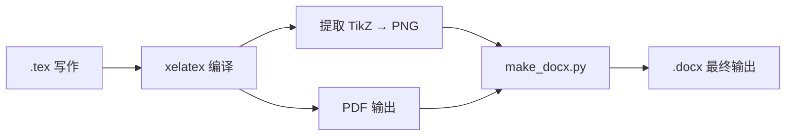

# LaTeX to Word 论文工作流

## Overview

一条龙完成中文论文的 LaTeX 写作 → PDF 编译 → Word 格式转换。核心思路：用 LaTeX 保证排版质量（TikZ 绘图、booktabs 表格、ctex 中文支持），通过 python-docx 将成品无损转入 Word 格式，同时满足学术投稿和作业提交的需求。

## Recommended Directory Structure

每次写论文新建项目文件夹，按此结构组织：

```
项目文件夹/
├── 最终版/              # 最终交付件（3个文件，干净）
│   ├── 论文全文.pdf
│   ├── 论文全文.docx
│   └── 论文全文.tex
├── 图片/                # 论文中使用/生成的图片
│   ├── fig1_xxx.png
│   └── fig2_xxx.png
├── 工作文件/            # 中间产物（别人不看）
│   ├── make_docx.py     # python-docx 转换脚本
│   ├── figures/          # TikZ standalone .tex 源文件
│   ├── plan/             # 写作规划文档
│   ├── lunwen.*          # LaTeX 编译产物（.log .aux .toc .out）
│   └── *旧版本.docx
├── 参考资料/            # 作业原文、参考文献等
│   └── *.docx / *.pdf
├── lunwen.tex           # 主 LaTeX 源文件（根目录，方便编辑）
└── lunwen.pdf           # 最新 PDF（根目录，方便预览）
```

**原则：** 根目录只放最常用的文件（.tex + .pdf），写完归档到`最终版/`，中间产物丢`工作文件/`，论文用的图片放`图片/`。

## Workflow



## Step-by-Step

### 1. LaTeX 写作规范

**必须使用的包：**
```latex
\usepackage[UTF8]{ctex}       % 中文支持
\usepackage{tikz}              % 绘图
\usetikzlibrary{positioning}   % 节点定位（架构图）
\usepackage{booktabs}          % 三线表
\usepackage{float}             % 浮动体控制 [H]
```

**编译命令：** 必须用 `xelatex`（不支持 `pdflatex`）
```bash
xelatex lunwen.tex
```

### 2. TikZ 图片处理

每个 TikZ 图需要提取为独立文件，编译为 PDF 再转 PNG：

**standalone 模板：**
```latex
\documentclass[border=5pt]{standalone}
\usepackage[UTF8]{ctex}
\usepackage{tikz}
% 如果有定位库：
\usetikzlibrary{positioning}
\begin{document}
% tikzpicture 代码从这里粘贴
\end{document}
```

**编译与转换：**
```bash
xelatex fig1.tex
python -c "
import fitz
doc = fitz.open('fig1.pdf')
page = doc[0]
pix = page.get_pixmap(dpi=200)
pix.save('fig1.png')
"
```

### 3. python-docx 模板

模板脚本见 `make_docx.py`，功能：
- 页面设置：上下 2.5cm、左右 3cm
- 中文排版：宋体正文 12pt、黑体标题、首行缩进 2 字符、1.5 倍行距
- 嵌入图片（居中 + 图注）
- 表格（居中 + 表头加粗 + 表注）
- 英文使用 Times New Roman

**运行：**
```bash
python make_docx.py
```

### 4. 模板脚本位置

`e:/skill/skills/latex-to-word-paper/make_docx.py`

每次新论文时复制到工作目录修改。

## make_docx.py 核心函数

| 函数 | 作用 |
|------|------|
| `set_run_font(run, cn_font, en_font, size, bold)` | 统一设置中西文字体 |
| `add_cn_paragraph(doc, text, ...)` | 添加中文段落（自动缩进、行距） |
| `add_heading_cn(doc, text, level)` | 添加中文黑体标题 |
| `add_figure(doc, img_path, caption)` | 插入居中图片 + 图注 |
| `add_table_comparison(doc)` | 插入对比表格（网格线 + 表注） |

## Common Mistakes

1. **中文引号冲突**：`.tex` 中的 `"..."` 写到 Python 字符串里时，Python 定界符必须用单引号 `'...'`，否则 SyntaxError
2. **TikZ 字体**：standalone 文件里必须加 `\usepackage[UTF8]{ctex}`，否则中文不显示
3. **png 路径**：将图片放到工作目录 `figures/` 下，make_docx.py 中路径要对应
4. **表格宽度**：5 列表格可能超出 15cm 版心，用 `\small` 或 8.5pt 字号缩小
5. **分页符**：在摘要和正文之间加 `doc.add_page_break()`
